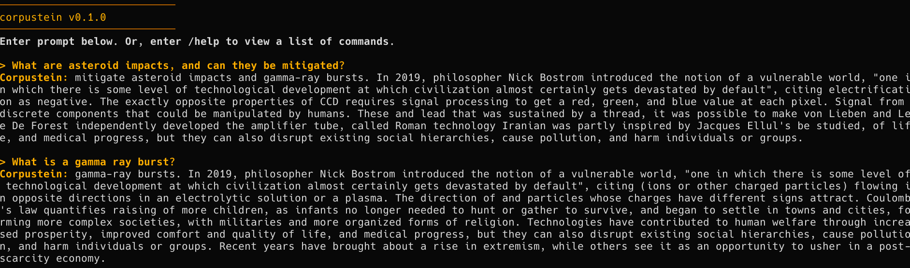

# corpustein

Corpustein is a **blazingly fast N-gram Markov Chain model with a configurable order and a rolling window system.** It is coded only in the C++20 Standard Library, which makes it **small and fast**. It even uses an **alternate terminal buffer** to make it look **sleek and beautiful.**



[](https://github.com/tyleruploads/corpustein/blob/main/LICENSE)
[](https://github.com/tyleruploads/corpustein/issues)
[](https://isocpp.org/)

## Features

- **Fast and Lightweight:** Built only on the C++20 STL, Corpustein is fast and consumes virtually no resources.
- **Custom Corpus Loading:** Users can load custom corpus files to be used by Corpustein. Additionally, Corpustein comes with a vast array of default options already baked into the program for them to load.
- **Automatic Configuration:** Corpus files contain metadata that provides default settings for the model to use, determined by the content of the corpus, by its creator. If the file appears to just be a normal text file without any sort of metadata, it will skip the default settings gracefully.
- **Compatibility:** With portable, native binaries automatically generated by the CI/CD for both Linux and Windows, Corpustein can be used on just about any system.
- **Commands and Settings:** Corpustein contains various commands users can run while in the interactive terminal environment to control many things about the model, like the order, maximum sentence count, and much more.
- **Alternate Terminal Buffer:** Corpustein uses an alternate terminal buffer to make a beautiful, stylized environment. Users are able to enable and disable this alternate terminal buffer right in the CLI.
- **Discrete Handling:** When the model runs out of token choices, instead of simply stopping the answer, it will choose a new, random token to continue generating text, with the user never knowing it ran out of tokens in the first place.
- **Context-Intelligent Repetition Avoidance:** Corpustein saves tokens to a history set to prevent repetition in its responses. It references tokens with a set of common English words to never force it into choosing a completely random token because of the avoidance of basic linguistic structural words
- **Configurable Typewriting Animation:** Instead of throwing the model's entire response to the terminal all at once because of how fast it is, it uses a configurable typewriting animation to make it more appealing.

## Usage

Type your prompt after the `>` symbol, and press Enter. Corpustein will instantly generate text, faster than a blink of the eye.

Corpustein also supports many slash commands. See the [Commands](#commands) section to view available slash commands.

## Download

To run Corpustein, simply download the appropriate binary for your Operating System from the table below.

| Linux | Windows | macOS |
| :---: | :---: | :---: |
| [**Linux Executable tar.gz (x86_64)**](https://github.com/tyleruploads/corpustein/releases/latest/download/corpustein-x86_64.tar.gz) | [**Windows Executable ZIP (x86_64)**](https://github.com/tyleruploads/corpustein/releases/latest/download/corpustein-win64.zip) | Not Automatically Compiled by CI/CD |

### Note for Linux Users

You may need to mark the binary as executable before it can be run.

```bash
mkdir corpustein
tar -xzvf corpustein-x86_64.tar.gz -C corpustein
cd corpustein


chmod +x corpustein.x86_64
```

### Note for Windows Users

If you do not know what to do with the zip file, follow these steps.

1. Download [corpustein-win64.zip](https://github.com/tyleruploads/corpustein/releases/latest/download/corpustein-win64.zip) and extract it
2. Open the extracted folder, navigate to the `release_staging_windows` folder, and then run the file named `corpustein.exe` (the file extension may not be automatically shown to you)
3. If a SmartScreen window is displayed:
    + Click More Info under the text
    + Click the Run Anyway button at the bottom
    + Note: This is normal behavior for open-source software not signed with a commercial Microsoft developer key

## Directory Structure

Corpustein uses a very simple but specific directory structure. When compiling with CMake, it will be automatically constructed and perfectly usable without any sort of manual configuration. The same is true when you install a `.tar.gz` or `.zip` file automatically attached to every GitHub Release. In case, for some reason, you wish to compile it on your own without CMake, you should refer to this directory structure. Only `corpus_0.txt` is required in the `corpora` directory. Everything else is optional. Also, the `corpora` directory must be a sibling of the executable file to make sure it finds it properly.

```text
.
├── corpora
│   ├── corpus_0.txt
│   ├── corpus_10.txt
│   ├── corpus_1.txt
│   ├── corpus_2.txt
│   ├── corpus_3.txt
│   ├── corpus_4.txt
│   ├── corpus_5.txt
│   ├── corpus_6.txt
│   ├── corpus_7.txt
│   ├── corpus_8.txt
│   └── corpus_9.txt
└── corpustein executable
```

If you would like to add more corpora to the defaults, simply add another file to the `corpora` directory, following the naming scheme evident above.

## Corpus File Structure

If you would like to embed default settings inside your own corpus file to be automatically applied by Corpustein as it is being loaded, follow the structure below. If you do not want default settings to be changed as it is being loaded, you do not need to follow this structure. Please note that if you are making a corpus file and intend it to be included as a default corpus, you must follow the custom structure for the corpus's name to be listed with the `/load default` command when no arguments are passed.

```text
io.github.tyleruploads.corpustein:corpus-file
name: The name of the corpus
default_order: The default order (1-8)
max_sentence_count: The maximum sentence count for responses generated by Corpustein (1-50)
===

(INSERT CORPUS HERE)
```

## Commands

To run a command, simply type a slash and then the command name after the `>` mark signifying user input.

### /help

The `/help` command displays a list of all other available slash commands. No arguments are processed.

### /version

The `/version` command views the version of Corpustein being run. No arguments are processed.

### /stats

The `/stats` command shows many variables relating to the current N-gram model. No arguments are processed.

**Statistics Shown, Ordered**

| Human-Readable Name | Variable | Description |
| :---: | :---: | :---: |
| Corpus Name | `current_corpus_name` | The name of the current loaded corpus. |
| N-gram Order Size | `ngram_size` | The current order of the unique N-gram contexts and rolling token window |
| Tokens in Corpus | `token_count` | The total amount of tokens in the current loaded corpus. Duplicates are not removed from the count |
| Unique N-gram Contexts | `context_count` (scope limited to `function_runner` set) | The total number of unique N-gram contexts created by the tokens found in the current loaded corpus |
| Health Ratio | `health_ratio` (scope limited to `function_runner` set) | A health ratio created by dividing the total token count by the unique N-gram contexts |
| Maximum Sentence Count | `max_sentence_count` | The number of sentences Corpustein will generate per response, unless stopped early by the maximum token count |
| Maximum Token Count | `max_token_count` | The number of tokens Corpustein will generate per response, unless stopped early by the maximum sentence count |
| Max Tokens in History | `max_history_size` | The maximum number of tokens stored in the history, which is used to prevent repetitions of tokens. Tokens corresponding to common English words such as "the", "as", "and", etc., are allowed to be repeated by the model |
| Typewriting Delay (ms) | `typewriter_delay_ms` | The delay between the sending of each character in the model's output to the standard output buffer in milliseconds |


### /set

The `/set` command allows users to change certain application variables.

**Subcommands and Flags with Detailed Explanations**

| Subcommand | Flag | Variables Affected | Description |
| :---: | :---: | :---: | :---: |
| `help` | N/A | N/A | Displays a list of available subcommands |
| `order` | `<integer 1-8>` | `ngram_size`, `ngram_contexts`, `ngram_dis` | Changes the order of the N-gram model to the integer provided in the subcommand flag. |
| `delay` | `<integer 1-50>` | `typewriter_delay_ms` | Changes the delay between the sending of each character in the model's output to the standard output buffer in milliseconds |
| `max_sentence_count` | `<integer 1-50>` | `max_sentence_count`, `max_token_count`, `max_history_size` | Sets the maximum sentence count for each of the model's responses. The maximum token count and maximum history size are automatically scaled to 40 times greater than the new maximum sentence count and four tenths of the new maximum token count, respectively |
| `altbuffer` | `<boolean>` | `use_alt_buffer` | Enables or disables the alternate terminal buffer. While using the alternate terminal buffer, detailed styling is applied, but scrolling and viewing the output after the application's execution ends is disabled. |


### /load & /reload

The `/load` command allows users to load either default or custom corpora. It takes a type and a corpus file in the following format: `/load <type> <corpus>`. The two types are `default` and `custom`.

**Default:** Load a default corpus file for the model to use. You must pass just the index of the corpus to load it. To view default corpora, run the default subcommand with no flag, and you will be provided with a list of corpus IDs, linked to their name. Default corpus files are found in the `corpora` sibling directory to the binary directory. The corpora directory is automatically populated by GitHub Actions for the downloads attached to Releases, but users can also add corpora on their own, as long as they follow the naming scheme of `corpora_integer.txt`.
**Custom:** Load a custom corpus file. Pass the path of the corpus, preferably absolute. If the path is not absolute, it will be expanded using the current working directory.

---

The `/reload` command reloads the current corpus, which is important for when users are making custom corpora and would like to make a hot-swap. It takes no arguments.

### /clear & /exit

The `/clear` command clears the current terminal buffer, applies ANSI codes initially run during initialization, and remakes the header at the top of the terminal. The `/exit` command reverts ANSI codes and exits the application. No arguments are processed by either command.

## Contributing

Contributions are what make open-source projects important. All contributions are highly appreciated.

* **Found a bug or issue**: Open an Issue and thoroughly explain the problem and the steps to reproduce it.
* **Have an idea**: Open an Issue and explain your idea as much as possible and why you think it would be a good addition to Corpustein.

## Security

For information on reporting security vulnerabilities in Corpustein, see [SECURITY.md](SECURITY.md)

## License

This project is licensed under the MIT License - see the [LICENSE](LICENSE) file for more information.
